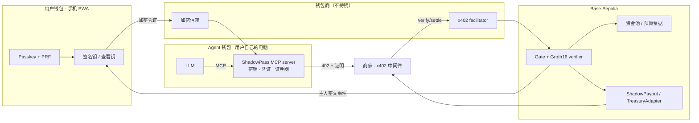

# ShadowPass

**给 AI Agent 的隐私预付卡。** 用 Face ID 给你的任何 Agent（Claude、OpenClaw……）发一张卡：有额度、有用途限制、随时冻结。Agent 每一笔消费都瞒不了你，而商家和钱包商都不知道这张卡属于谁。

> 黑客松原型，基于 ZK-HADA 研究中的 ZK-DAC v9.2 委托电路。未经生产审计，可信设置仅为本地单次贡献，只用于测试网演示。

## 为什么

主流 Agent 钱包（Coinbase Agentic Wallets、Privy、Turnkey）让 Agent 不碰私钥，但：
- **钱包商看得到一切**：你授权了哪些 Agent、每一笔花在哪里；
- **商家和链上看得到付款人**：钱从你的地址付出，消费可以被串起来。

ShadowPass 保留同样的四方结构（用户、Agent、钱包商、商家）和同样的体验，但：

| | 主流方案 | ShadowPass |
|---|---|---|
| 商家 / 链上看到 | 你的地址 | 资金池里某个已授权的 Agent |
| 钱包商看到 | 全部授权和花费 | 只有入金金额 |
| 谁能对账 | 钱包商 | 只有你，用自己的查看钥，Agent 瞒不了 |
| 多级 Agent | 公开或不支持 | 零知识委托链，能力和有效期逐级收窄 |
| 吊销 | 钱包商侧 | 链上，不需要 Agent 配合 |

## Demo：采购 + 理财

```
Alice（7 天，100 USDC）
 └─ 管家（Alice 钱包里的分配钥） {PAY, TREASURY}   分配预算、签发和吊销 Agent
     ├─ 采购 Agent {PAY}             通过 x402 买报告、订阅新闻
     └─ 理财 Agent {TREASURY}        把闲置预算存入白名单金库，只能回到预先承诺的票据
```

被提示注入攻破的采购 Agent 碰不到理财资金；理财 Agent 付不了款。两支的每一笔都只有 Alice 能解密查看；出问题只吊销那一支。

本地一键复现、三分钟剧本、对照面板说明和备用录屏见 [演示文档](docs/demo/README.md)。

## 密码学方案怎么讲

一句话版本：

> ShadowPass 不把 Alice 的地址交给合约，而是让 Agent 证明：自己确实持有一张由 Alice 委托、未过期、未吊销、权限足够，并且还没花过的匿名预算凭证；链上不知道这张凭证属于谁，Alice 仍能解开完整委托链对账。

方案可以拆成四层：

1. **匿名委托凭证**：Alice 的根密钥派生出管家，再签发采购 Agent（`PAY`）和理财 Agent（`TREASURY`）。Agent 用 Groth16 证明完整委托链有效、能力位不超过父级、凭证未过期且未被吊销，但不公开整条链。
2. **匿名预算票据**：预算进入共享资金池后变成票据树中的承诺。付款证明只说明“我控制池子里一张有效票据”，不说明它来自 Alice 的哪次入金。
3. **Nullifier 防双花**：每张票据消耗时产生稳定 nullifier。重复花费同一张票据会被拒绝，但观察者不能从 nullifier 反推出 Alice。
4. **主人可审计**：每笔交易附带只有 Alice 查看公钥能解开的 `OwnerCiphertext`。商家和观察者只看到密文，Alice 钱包能解出 `Alice → 管家 → Agent`、金额和交易。

现场最直观的展示是同时打开三个视角：

| 视角 | 能看到什么 | 讲解重点 |
|---|---|---|
| 公开链 | 资金池、Groth16 证明、nullifier、票据根、金额、不可读的主人密文 | 只能确认“池内一张有效票据被使用”，没有 Alice 或 Agent 的长期身份 |
| 商家 | 金额、订单、结算交易、池内已授权付款 | 确认收款，但无法把该用户的其他消费串起来 |
| Alice 钱包 | 两条分支、完整委托链、金额、交易、未上报提醒 | 对外匿名不等于主人无法审计 |

可以在链上指出：付款交易的 `from` 是 facilitator，`to` 是 Gate/Payout；交易参数中没有 Alice 地址或明文委托链。对照普通 EOA、ERC-7710 或 session key 时，链上通常会公开 Alice 的智能账户、授权关系和执行路径。

一分钟讲解稿：

> Alice 用 Touch ID 派生根密钥，把预算拆成采购和理财两张受限凭证。Agent 付款时生成零知识证明，证明自己持有一条未过期、未吊销、权限匹配的委托链，并且拥有池子里一张没花过的预算票据。链上只看到证明、nullifier、金额和只有 Alice 能解开的密文。商家能确认收款，但看不到 Alice 或 Agent 的长期身份；重复使用同一张票据会被 nullifier 拒绝。最后 Alice 打开钱包，用自己的查看钥解出完整账单。所以对外匿名，对主人不完全匿名。

需要诚实说明：ZK 让链上只保留“交易有效”的结论，不保留“谁授权”的答案；但金额、时间、目标、交易存在性和网络元数据仍可能公开。匿名强度取决于可关联票据集合，当前演示预置的 20 个模拟账户只扩大票据层匿名集，不代表生产级身份匿名性。

## PTAU 与可信设置

`PTAU`（Powers of Tau）是 Groth16 的通用第一阶段可信设置参数，不是私钥，也不是 ShadowPass 专用数据。ShadowPass 复用它为 `main_d2`、`main_reg`、`main_revoke`、`budget_transfer` 和 `budget_mint` 生成各电路自己的 `.zkey`。

官方演示文件是 `powersOfTau28_hez_final_18.ptau`：

- 大小：302,072,984 字节
- SHA-256：`e970efa7774da80101e0ac336d083ef3339855c98112539338d706b2b89ac694`
- 自动下载地址：`https://circom.info/powersOfTau28_hez_final_18.ptau`
- 不进入 git；首次生成后的 `.zkey`、WASM 和 verifier 缓存在 `scripts/mvp/.runtime/artifacts/`

如果本地已有文件，可以显式指定：

```bash
export SHADOWPASS_PTAU=/absolute/path/to/powersOfTau28_hez_final_18.ptau
npm run demo:mvp
```

没有指定时，MVP 会和协议层演示一样下载并校验哈希，支持断点续传。当前 ShadowPass 的 phase-2 是单次本地贡献，只适合测试网和黑客松演示；生产环境需要独立审计和多方可信设置仪式。

## 架构



## 仓库结构

| 路径 | 内容 | 状态 |
|---|---|---|
| `circuits/` | ShadowPass 电路（v9.2 + 主人查看钥 + 主人密文）、witness 生成器、测试、setup | ✅ |
| `contracts/` | Foundry：verifier、Gate、Registry、Payout、TreasuryAdapter | 🚧 |
| `packages/sdk/` | 链上状态同步、witness、证明、凭证包、信箱客户端（唯一实现，各方共用） | ⏳ |
| `packages/x402/` | `shadowpass` scheme 的 client / server / facilitator 类 | ⏳ |
| `packages/mcp/` | Agent 端 MCP server：本地密钥、配对、凭证同步、SDK 证明与 x402 付款（#7 第 2 步） | 🚧 |
| `services/facilitator/` | x402 facilitator + 钱包交易代付 | ⏳ |
| `services/merchant-demo/` | 示例商家（官方 x402 中间件） | ⏳ |
| `services/mailbox/` | 加密信箱与备份槽（SQLite / Upstash） | 🚧 |
| `apps/wallet/` | 用户钱包 PWA 骨架：passkey + PRF、SDK key 派生、备份槽 | 🚧 |
| `deployments/` | 各网络合约地址 | ⏳ |
| `spikes/` | 一次性实验及结论 | ✅ x402 自定义 scheme |
| `vendor/zk-hada-exp/` | 研究仓库的只读副本（来源见 `docs/PROVENANCE.md`） | 只读 |
| `docs/` | 产品方案、开发计划、接口规范、基线 | |

## 文档

- [产品方案](docs/PRODUCT.md)（含风险与边界）
- [开发计划与状态](docs/DEV_PLAN.md)
- [代码架构](docs/ARCHITECTURE.md)：monorepo 结构、依赖方向、SDK API、产物分发、CI
- [共享接口规范](docs/INTERFACES.md)：所有工单共同的约定
- [部署](docs/DEPLOY.md)：Vercel 项目配置、证明产物托管、常见报错
- [端到端演示](docs/demo/README.md)：一键启动、模拟匿名集、浏览器验收、剧本与答辩材料
- [MVP 产品演示](docs/mvp/README.md)：钱包 PWA + 单主 Agent/双 subagent + facilitator + 信箱 + 商家的完整本地链路
- [开发 Agent 工作约定](AGENTS.md)
- 工作拆分：见 Issues，总览在 tracking issue

## 当前数据（Apple M5 Pro，snarkjs 0.7.6）

| 电路 | 约束 | 公开输入 | 证明中位耗时 |
|---|---|---|---|
| D1（管家） | 60,801 | 15 | 0.89 s |
| D2（采购 / 理财） | 107,793 | 16 | 1.56 s |
| D3（下级 Agent） | 154,785 | 17 | 2.46 s |
| 注册 | 17,608 | 4 | 0.36 s |

D2 旧 A1 verifier 链上验证 291,606 gas；A2 verifier 的 gas 由合约工单复测。详见 `circuits/README.md`。

## 复现研究基线

```bash
cd vendor/zk-hada-exp/work/t4_contracts && npm ci && cd foundry && forge test --match-contract 'V92Test|V92PolicyTest'   # 45 tests
cd vendor/zk-hada-exp/work/t2_circuit_fix/zkdac_v7 && npm ci && cd ../zkdac_v9_2 && node scripts/smoke.mjs                 # needs build/, see docs/PROVENANCE.md
```

## 本地链

```bash
npm install
npm run dev:chain
```

脚本会启动 Anvil、部署全部合约、校验链上地址、从成功的广播产物写入 `deployments/anvil.json`，并给三个 Anvil 测试账户各发 `1000 spUSD`。`ANVIL_PORT` 同时决定启动端口和 RPC 地址；复用已有节点时会拒绝非 `31337` 的链。默认 Anvil 私钥只用于本地链。

重复运行会部署一套新合约并覆盖 `deployments/anvil.json`，不是幂等操作；不带 `--broadcast` 的模拟不会写部署文件。

需要测试网部署时，把 `DEPLOYER_PK`、`BASE_SEPOLIA_RPC` 放进本地 `.env`，然后运行：

```bash
set -a && source .env && set +a
export SHADOWPASS_NETWORK=base-sepolia
(cd contracts && forge script script/Deploy.s.sol:Deploy --rpc-url "$BASE_SEPOLIA_RPC" --broadcast) &&
  node scripts/record-deployment.mjs --rpc-url "$BASE_SEPOLIA_RPC"
```

部署脚本只接受 Anvil `31337` 和 Base Sepolia `84532`，其他链（包括主网）会直接拒绝。部署文件只在广播成功、所有回执成功且链上地址校验通过后生成。不要提交 `.env` 或任何测试网私钥。
