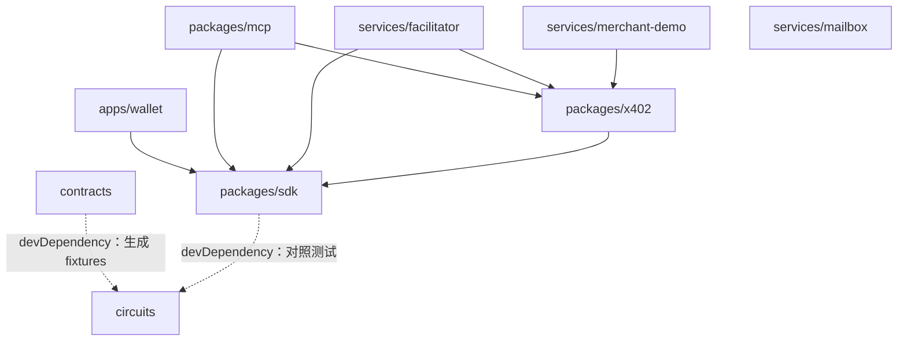

# 代码架构

npm workspaces 管理的 monorepo。Node 24（`.nvmrc`），ESM only，TypeScript strict（`tsconfig.base.json`），测试用 vitest，合约用 Foundry，电路用 circom 2.2.3。所有包都是 `private`，不发布到 npm。

## 1. 目录与包

```
shadowpass/
├─ package.json              workspaces + 根脚本（typecheck / test / build）
├─ tsconfig.base.json        各 TS 包 extends 它
├─ .env.example              所有环境变量的清单（.env 不进 git）
├─ circuits/                 @shadowpass/circuits     circom 源码、witness 参考实现、测试、setup、verifier
│  ├─ src/                   *.circom（main_d1/d2/d3、main_reg、main_revoke、budget_*）
│  ├─ scripts/               world.mjs（参考实现）、test.mjs、prove.mjs、build.sh、setup.sh、publish-artifacts.sh
│  ├─ zk/                    vk_*.json、*Verifier*.sol、MANIFEST.sha256（进 git）
│  └─ build/                 r1cs / wasm / zkey（不进 git）
├─ contracts/                @shadowpass/contracts    Foundry 工程
│  ├─ src/                   ShadowGate、ShadowRegistry、ShadowGroup、ShadowRevocations、ShadowPayout、TreasuryAdapter、MockVault、ShadowToken、verifier
│  ├─ test/                  *.t.sol + fixtures/*.json（真实证明，进 git，CI 不需要 circom）
│  └─ script/                Deploy.s.sol、gen-fixtures.mjs（调用 @shadowpass/circuits/world）
├─ packages/
│  ├─ sdk/                   @shadowpass/sdk          所有链下逻辑的唯一实现（Node 与浏览器共用）
│  ├─ x402/                  @shadowpass/x402         “shadowpass” scheme 的 client / server / facilitator 三个类
│  └─ mcp/                   @shadowpass/mcp          Agent 端 MCP server（bin: shadowpass-mcp）
├─ services/
│  ├─ facilitator/           @shadowpass/facilitator  x402 facilitator + 钱包交易代付端点
│  ├─ mailbox/               @shadowpass/mailbox      加密信箱 HTTP 服务
│  └─ merchant-demo/         @shadowpass/merchant-demo 官方 x402 中间件 + 我们的 scheme 的示例商家
├─ apps/
│  └─ wallet/                @shadowpass/wallet       用户钱包 PWA（Vite + React），部署到 shadowpass-wallet.vercel.app
├─ deployments/              anvil.json、base-sepolia.json（INTERFACES §10）
├─ scripts/                  dev-chain.sh（本地链一键环境）、demo/
├─ spikes/                   一次性实验（不被任何包引用）
├─ vendor/zk-hada-exp/       研究代码只读副本（不被任何包在运行时引用）
└─ docs/
```

## 2. 依赖方向（只能向下依赖）



规则：
- `sdk` 不依赖任何内部包，是 witness、证明、密钥、哈希、树、凭证包、信箱客户端的**唯一实现**。其他包不得重复实现这些逻辑（比如 ctx_hash、凭证哈希、树）。
- `circuits/scripts/world.mjs` 是**参考实现**，只用于电路测试和合约 fixtures。`sdk` 用它做逐字段对照测试，但运行时不引用。
- 运行时禁止引用 `vendor/` 和 `spikes/`。
- 内部依赖在 `package.json` 里写 `"@shadowpass/xxx": "*"`，由 workspaces 解析为本地包；源码直接导出 `src/index.ts`（`exports` 指向 TS 源码，用 `tsx` / Vite 运行）。需要打包时由各包自行加 `build`。
- 外部依赖统一：链交互用 **viem**（不用 ethers），证明用 **snarkjs 0.7.6**，BabyJub/EdDSA/Poseidon 用 **circomlibjs 0.1.7** 和 **poseidon-lite 0.3.0**，Merkle 树用 **@zk-kit/lean-imt 2.2.5**，信箱和备忘加密用 **libsodium-wrappers 0.7.15**，x402 用 **@x402/* 2.28.0**，MCP 用 **@modelcontextprotocol/sdk**，校验用 **zod**。版本在首次引入时固定（不用 `^`）。

## 3. `@shadowpass/sdk` 的模块与对外 API（工单 #6 实现，其他工单按此调用）

| 模块 | 主要导出 | 使用方 |
|---|---|---|
| `keys` | `deriveKeys(seed) -> { sign, steward, view, box }`、`wrapSeed / unwrapSeed(prf, …)`、`recoveryWrap / recoveryUnwrap`、`identityFromPrv(prv)` | wallet、mcp |
| `types` | `Deployment`、`Identity`、`ViewKey`、`Cert`、`Note`、`Action`、`Bundle`、`OwnerCiphertext`、`BillEntry` | 全部 |
| `deployment` | `loadDeployment(network \| json)` | 全部 |
| `certs` | `issueRoot(...)`、`issue(parent, ...)`、`certHash0`、`certHash` | wallet、mcp |
| `state` | `class ChainState { static sync(client, deployment, opts) ; update() ; roots() ; issued ; revoked ; rootTree ; notes ; group }` | wallet、mcp、facilitator |
| `events` | `decodeShadowEvent`、`shadowEvents`、`shadowEventTopics` | wallet、mcp、facilitator |
| `witness` | `actionInput`、`groupCommitment`、`registerInput`、`revokeInput`、`revokeCertInput`、`revokeKeyInput`、`transferInput`、`mintInput` | wallet、mcp |
| `prove` | `loadArtifacts({ baseUrl \| dir, circuit })`（按 MANIFEST 校验）、`prove(circuit, input, artifacts)`、`verify(...)`、`toCalldata(proof, publicSignals)` | wallet、mcp、facilitator |
| `ctx` | `ctxHash({ chainId, gate, action, memoChange })`、`reqHash({ network, asset, amount, payTo, resource })` | mcp、facilitator、x402 |
| `notes` | `encodeNoteMemo(note, recipientBoxPk)`、`decodeNoteMemo(memo, boxSk)`、`scanNotes(state, logs, { boxSk, holderSks })` | wallet、mcp |
| `owner` | `encryptChain`、`openChain(ct, vsk)`、`scanBill(state, logs, vsk) -> BillEntry[]` | wallet |
| `bundle` | `encodeBundle / decodeBundle`、`encodeMessage / decodeMessage`（receipt、delegated） | wallet、mcp |
| `mailbox` | `class MailboxClient { send(toPk, msg) ; poll(kp, after) ; pollAll(kp, after) }`、`MailboxEntry`（坏条目保留 id 并跳过） | wallet、mcp |

在 #6 交付之前，其他工单可以先写调用方代码，用 mock 实现这些签名。签名有变化时，#6 必须同步更新本表。

### 3.1 `@shadowpass/x402`（工单 #8 实现）

对外 API 见 `docs/INTERFACES.md` §8.4。x402 包只负责协议层：凭据 schema、§8.3 的检查、商家端和 facilitator 端的 scheme。**证明由调用方通过 `ShadowpassPaymentBuilder` 回调提供**，x402 包不依赖 Agent 的密钥和凭证。依赖：`@shadowpass/sdk`（`ctx`、`types`）、`@x402/core` 2.28.0、viem、zod。

### 3.2 `@shadowpass/mcp`（工单 #7 实现）

- `src/store.ts`：本地数据目录（默认 `~/.shadowpass/agents/<name>/`，权限 0700，文件 0600），保存 holder 私钥、信箱私钥、凭证包、票据、收据游标。
- `src/payment-builder.ts`：实现 `ShadowpassPaymentBuilder`（§8.4 的 5 个步骤）。
- `src/server.ts`：MCP 工具 `wallet_status`、`pay`、`list_receipts`、`treasury_supply`、`treasury_status`（P1：`delegate`）。
- 链上状态：`sdk.state.ChainState`，地址从 `deployments/<network>.json` 读取。

## 4. 证明产物的分发

- `circuits/scripts/publish-artifacts.sh`（#2 编写）：把 wasm、zkey、vk、`MANIFEST.sha256` 复制到 `apps/wallet/public/zk/circuits-v<N>/`（不进 git）。
- 钱包部署后，产物公开在 `https://shadowpass-wallet.vercel.app/zk/circuits-v<N>/`。如果 Vercel 构建不携带
  本地生成的产物，则把同一目录布局托管到不可变版本的 OSS/GitHub Release，并用
  `VITE_SHADOWPASS_ARTIFACTS` 和 `SHADOWPASS_ARTIFACTS` 指向该根 URL。zkey 不是秘密。
- MCP、facilitator、浏览器都通过 `SHADOWPASS_ARTIFACTS`（URL 或本地目录）加载。`sdk.prove.loadArtifacts` 校验 zkey/vk 时，**以 SDK 内置的哈希表为准**（由 `scripts/generate-artifact-hashes.mjs` 从仓库里提交的 `circuits/zk/MANIFEST.sha256` 生成），不能只信托管方返回的 MANIFEST，否则恶意托管方可以同时替换 zkey、vk 和 MANIFEST。
- 改了电路就升版本号，verifier 同步重新部署。当前版本是 `circuits-v2`（A2）；`.env.example` 的默认值同步改为 v2。

## 5. 配置

- 合约地址：只从 `deployments/<network>.json` 读取，`SHADOWPASS_NETWORK` 选网络。不在代码里写死地址。
- 机密只放环境变量，清单见 `.env.example`。
- 钱包：`rpId = "shadowpass-wallet.vercel.app"` 写死，本地开发用 `localhost`；Vercel 预览部署不能用 passkey。

## 6. 测试与 CI

- 每个 TS 包的 `tsconfig` 要覆盖 `src` 和测试目录（可单独加 `tsconfig.test.json`），`npm run typecheck` 必须检查到测试代码。
- 每个包 `npm test` 必须不依赖 circom 和本地链即可运行（需要证明的测试用进 git 的 fixtures 或标记为集成测试 `*.int.test.ts`，CI 跳过）。
- 合约测试用 `contracts/test/fixtures/*.json`（真实证明，由 `npm run fixtures -w @shadowpass/contracts` 生成并提交）。
- CI（`.github/workflows/ci.yml`）：`npm ci` → `npm run typecheck` → `npm test -w packages -w services -w apps -w contracts`（不含 circuits，它需要 circom 和 build 产物；contracts 的 test 脚本即 `forge test`）。
- 集成测试在本地用 `scripts/dev-chain.sh` 起 anvil 后运行。

## 7. 常用命令

```bash
nvm use && npm install                      # 一次安装全部 workspace
npm run typecheck && npm test               # 全部包
npm test -w @shadowpass/sdk                 # 单个包
npm run build -w @shadowpass/circuits       # 编译电路（需要 circom 2.2.3）
(cd contracts && forge test)
```
